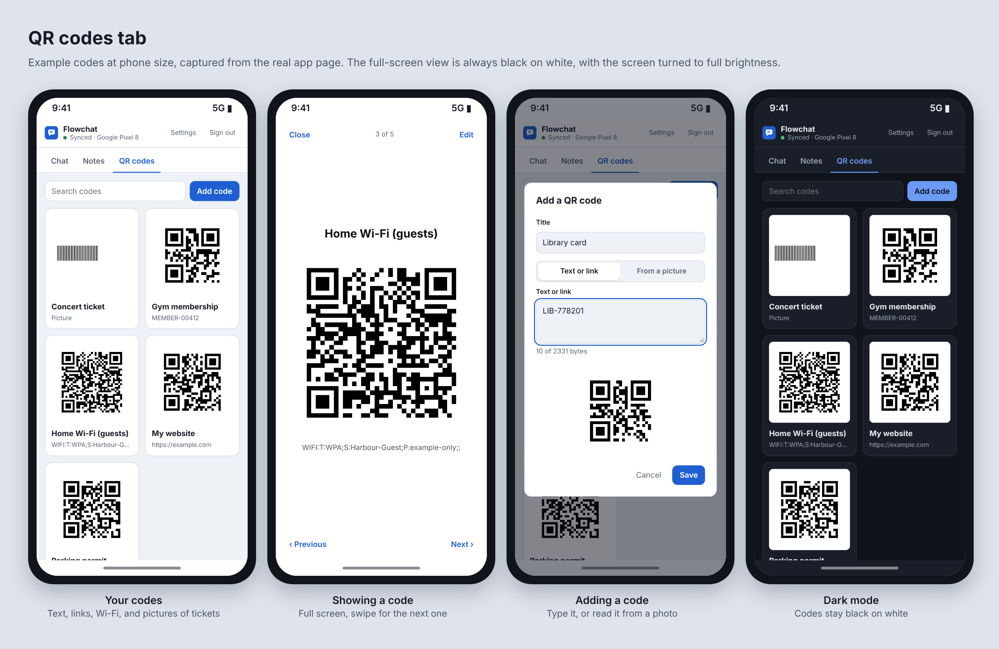
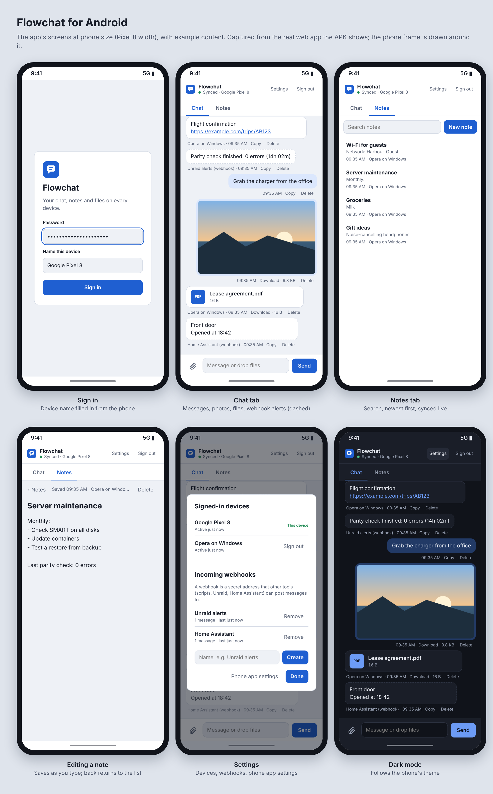

# Flowchat

A personal chat and file drop you host yourself. Sign in from any browser, write
notes, paste links, share files, and pick up where you left off on another device.

- One password, long-lived sign-in per device (90 days by default)
- Messages and files appear live on every signed-in device
- Tabs for **Chat**, **Notes** and **QR codes**, all synced live and encrypted on the server
- Drag and drop, paste, or pick files; images, video and audio preview in place
- "Devices" lists every signed-in browser and can sign any of them out
- No database and no npm packages: everything lives in one `/data` folder
  (two small QR libraries are included in `public/vendor/`; see `THIRD-PARTY.txt` there)

## QR codes



Keep tickets, membership cards, Wi-Fi details and links ready to show to another
phone or a scanner. Tap a code to show it full screen, black on white; swipe or
use the arrow keys for the next one. In the Android app the screen goes to full
brightness and stays on while a code is shown.

- **Add a code** by typing the text or link, or by choosing a photo or screenshot.
  A QR code in the picture is read and redrawn sharply. Anything else (barcodes,
  Aztec boarding passes) is kept as the picture itself.
- **In the Android app** QR codes have their own screen, built into the app: from
  the QR codes tab, the "QR codes" bar (servers older than this feature), the
  "Show my QR codes" button when the server is unreachable, or a long press on the
  app icon. Codes are stored on the phone encrypted with a key in Android's
  keystore, work with no connection at all, and sync both ways with the server:
  changes made on the phone (also offline) are sent when the server is reachable,
  and changes made in a browser arrive on the phone. If the same code is changed in
  both places, the last change to reach the server wins; a code edited on the phone
  but removed elsewhere is kept. Pictures are read with ZXing, which also recognises
  barcodes and boarding passes. Signing out removes every code from the phone.
- **If a phone is lost:** your codes are on the server, encrypted with your
  password, so nothing is lost with the phone. Sign the phone out in Settings →
  Signed-in devices: it erases its own copy the next time it connects, and the
  server keeps everything. Sign in on the new phone and the codes come back.
  Codes added on the lost phone but never synced (it was offline the whole time)
  can't be recovered.
- **Recently removed:** a removed code, including one removed on a phone, stays on
  the server for 30 days. Restore it, or delete it for good, in Settings →
  Recently removed QR codes.
- **In browsers without a connection:** codes are kept in the browser so they can
  be shown when the server is out of reach, if the app is served over HTTPS
  (browsers only allow offline pages on HTTPS). Untick "Keep codes on this device"
  to turn it off. Signing out removes the copy. In a browser this copy is not
  encrypted, so keep the device locked.

## Install on Unraid

Every push to `main` builds a new image and publishes it as
`ghcr.io/elremeithi/flowchat:latest`, so Unraid can install and update it like
any other app.

1. Save the template to the Community Applications private folder:

   ```bash
   mkdir -p /boot/config/plugins/community.applications/private/elremeithi
   wget -qO /boot/config/plugins/community.applications/private/elremeithi/flowchat.xml https://raw.githubusercontent.com/elremeithi/flowchat/main/unraid/flowchat.xml
   ```

2. Open **Apps** → **Private Apps** → **flowchat** → **Install**.
   Set **Password**, check the port and data path, then Apply.
3. Open `http://<server-ip>:8080`.

Updates show up in the Docker tab like any other container. The **Auto Update
Applications** plugin can install them on a schedule.

With the Compose Manager plugin you can use `docker-compose.yml` instead: copy
`.env.example` to `.env` next to it and fill in your values (`.env` is git-ignored).

## Settings

| Variable | Default | Meaning |
| --- | --- | --- |
| `APP_PASSWORD` | generated | Sign-in password, and the key that unlocks your stored data. If unset, one is generated and saved in `/data/generated-password.txt`, which leaves the data unprotected; set your own. |
| `OLD_APP_PASSWORD` | unset | Only when changing the password: the previous one, for one start. See Security. |
| `ENCRYPTION_KEY` | unset | Only for upgrading data from an older version that used it, for one start. |
| `TOTP_SECRET` | off | Adds a 6-digit authenticator code to sign-in. |
| `REQUIRE_HTTPS` | `0` | `1` refuses plain HTTP. Use it behind an HTTPS proxy. |
| `ALLOWED_HOSTS` | any | Comma-separated addresses the app answers on. |
| `RETENTION_DAYS` | `0` | Auto-delete messages and files older than this. `0` keeps everything. |
| `WEBHOOK_URL` | off | Announce every new message to this address. Comma-separate several. |
| `WEBHOOK_SECRET` | off | Signs outgoing webhooks. |
| `WEBHOOK_INCLUDE_TEXT` | `1` | `0` announces only that a message arrived, without text or file name. |
| `MAX_UPLOAD_MB` | `2048` | Largest file that can be uploaded. |
| `SESSION_DAYS` | `90` | How long an unused device stays signed in. |
| `TRUST_PROXY` | `0` | Set to `1` behind a reverse proxy so login throttling sees real client addresses. |
| `PUID` / `PGID` | `99` / `100` | Owner of the files in `/data` (Unraid's nobody:users). |

Data: `/data/messages.jsonl`, `/data/sessions.json`, `/data/uploads/`. Back up that folder.

## Webhooks

**Incoming** (other tools post into the chat). Open Settings in the app, name a
webhook and press Create. The address is shown once; anyone who has it can post
messages (not read them), so treat it like a password. Remove a webhook in
Settings to switch its address off.

```bash
curl -d "Backup finished" https://flow.example.com/hook/<token>
```

```bash
curl -H "Content-Type: application/json" -d '{"title":"Array","text":"Parity check done"}' https://flow.example.com/hook/<token>
```

Accepted bodies: plain text, or JSON / form fields named `text`, `content`,
`message`, `body` or `description`, with an optional `title` or `subject`.
Limits: 256 KB per message, 60 messages a minute per webhook.

**Outgoing** (the chat notifies another service). Set `WEBHOOK_URL`; every new
message is sent there as a POST:

```json
{"event":"message","message":{"id":"…","ts":1794407089873,"from":"Opera on Windows","source":"device","text":"hello","file":{"name":"a.pdf","size":1234,"type":"application/pdf"}}}
```

`source` is `device` or `webhook`. File contents are never sent. With
`WEBHOOK_SECRET` set, each request carries
`X-Flowchat-Signature: sha256=<HMAC-SHA256 of the body>` so the receiver can
verify it. Outgoing webhooks send message text off the server; set
`WEBHOOK_INCLUDE_TEXT=0` to send only a "new message" notice. Outgoing addresses
are set in the container settings on purpose, so a signed-in browser cannot
redirect your messages elsewhere.

## Android app



`android/Flowchat.apk` is a small companion app (Android 10 or newer):

- **Chat** with your server's page, with the phone's file picker for attachments
  and downloads saved to the Downloads folder.
- **Share to Flowchat** from any app (photos, files, links, text). It asks before sending.
- **Webhook alerts as notifications** while the app is closed. Choose in the app
  settings: webhook alerts only (default), webhook alerts and messages from your
  other devices, or none. Alerts missed while the phone was offline are announced
  on reconnect (up to five, then a count).

Install: copy the APK to the phone, open it, and allow installing from that
source when Android asks. Enter your server address, sign in, and allow
notifications. Then, in the app settings (Settings → Phone app settings), tap
**Allow background use** so Android does not pause the connection.

To deliver alerts the app keeps one connection open and shows a silent
"Flowchat alerts" notification; hide it under Android's notification settings →
Flowchat → Background connection. On the lock screen alerts show only
"New Flowchat alert"; the text needs the phone unlocked. The app's data is
excluded from backups and phone-to-phone transfers. Screenshots and screen
recordings of the app are blocked, its preview in the recent-apps list is blank,
and it shows as black when the screen is shared or cast. This is on by default; turn
it off in the app's settings (Settings → Phone app settings → Privacy → Block
screenshots and screen recording), for example to screenshot a QR code.

Build it with `android/build.sh` on Ubuntu/Debian (packages listed at the top
of the script; it downloads the Android class library from Maven Central on the
first run). Sign with your own key:

```bash
KEYSTORE=~/keys/flowchat.jks KEYSTORE_PASS_FILE=~/keys/flowchat.pass KEY_ALIAS=flowchat android/build.sh
```

Without those variables the first build creates `android/flowchat.keystore` and
`android/flowchat.keystore.pass` (both git-ignored). **Keep the key private and
backed up**: Android only installs updates signed with the same key, and anyone
holding it can sign an app your phone would accept as an update.

## Security

Built in, nothing to configure:

- Sign-in cookies are HttpOnly and SameSite=Strict; over HTTPS they are also
  Secure and host-locked. Only a hash of each token is stored on the server.
- Repeated wrong passwords are throttled per address and overall, and logged.
- Other websites can neither send requests to the app nor load its files.
- Uploaded files are never run as web pages, and never kept in the browser's
  disk cache. Signing out clears what the browser stored.
- Data files are readable only by the app's user. The app process runs as a non-root user,
  in a container with a read-only filesystem and almost all capabilities dropped.

**Encryption at rest, always on, with your password.** Messages, notes, file
names and contents, the device list and webhooks are stored encrypted
(AES-256-GCM / AES-256-CTR) with a random data key. That key is kept in
`/data/key.json`, locked with a key derived from `APP_PASSWORD` (scrypt, about
128 MB of memory per guess, which makes guessing slow). A copy of the appdata
folder, such as a backup or a stolen disk, is unreadable without the password.
It does not protect against someone who controls the running server, because
the password is in the container settings.

- **Use a long password.** Someone holding a copy of the folder can try
  passwords offline; the scrypt cost slows that down but cannot save a short one.
- **Do not lose the password.** There is no recovery: without it the data is
  gone. Keep `key.json` together with the rest of the folder in backups.
- **Changing the password:** set the new one as `APP_PASSWORD` and the previous
  one as `OLD_APP_PASSWORD`, start once, then remove `OLD_APP_PASSWORD`. Only
  the small key file is re-locked; every device is signed out. If you change
  `APP_PASSWORD` without this, the app refuses to start rather than touch the data.
- **Upgrading from a version that used `ENCRYPTION_KEY`:** keep it set for one
  start; its data is moved under the password, after which it can be removed.
  Data from versions without encryption is encrypted automatically on first start.

Worth switching on:

**Two-step sign-in** (`TOTP_SECRET`). Create a secret:

```bash
docker run --rm --entrypoint node ghcr.io/elremeithi/flowchat:latest /app/server.js --totp-new
```

Put the printed `TOTP_SECRET` value in the container settings and add the same
secret to an authenticator app (manual entry, or turn the printed link into a
QR code on a device you trust). A stolen password alone then no longer signs in.

**If you think the password leaked:** change it as described above. Every
device is signed out. The Devices list shows who is signed in at any time, and
the container log records each sign-in and failed attempt.

## Reaching it from anywhere

Do not forward port 8080 straight to the internet: the app speaks plain HTTP.
Put it behind one of these:

- **Tailscale or WireGuard** (built into Unraid): simplest, nothing is public.
- **A reverse proxy with HTTPS** (Nginx Proxy Manager, SWAG, Caddy). Raise the
  proxy's upload limit to match `MAX_UPLOAD_MB` (nginx: `client_max_body_size 2048m;`)
  and turn off request buffering for large files (`proxy_request_buffering off;`).
  Set `TRUST_PROXY=1`, `REQUIRE_HTTPS=1` and `ALLOWED_HOSTS` to your address.
- **Cloudflare Tunnel**: works, but Cloudflare caps uploads at 100 MB on the free plan.

Over HTTPS the page can be installed as an app from the browser menu
("Install" / "Add to Home Screen").

## Run without Docker

```bash
APP_PASSWORD=secret DATA_DIR=./data node server.js
```

Needs Node 20 or newer.
